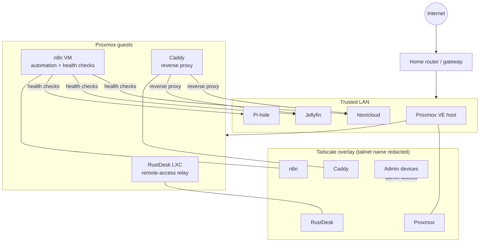

# Homelab

A self-hosted virtualization and networking lab I run and maintain day-to-day — not a one-time tutorial build. Proxmox hypervisor, a Tailscale overlay for all remote access, automated health monitoring, and a handful of self-hosted services I actually use.

> **Note on addresses:** every IP address, hostname, and tailnet name below is a placeholder. Real addressing is intentionally omitted — this repo documents architecture and reasoning, not a live target.

## Why I built this

I wanted infrastructure I was actually responsible for keeping up, not a disposable VM I'd tear down after a tutorial. Running my own hypervisor and wiring up remote access and monitoring the way I'd want it done at work is the fastest way I've found to actually learn the material instead of just reading about it.

## Architecture

## Tech stack

| Layer | What | Why |
|---|---|---|
| Hypervisor | Proxmox VE | Free, KVM-based, good enough clustering/snapshot story for a single-host lab |
| Remote access overlay | Tailscale (WireGuard-based) | Every admin surface (Proxmox UI, RustDesk, n8n, Caddy-fronted services) is reachable only over the tailnet — nothing is port-forwarded to the public Internet |
| Remote desktop | Self-hosted RustDesk relay (LXC) | Full control over the relay instead of trusting a third-party remote-desktop vendor; restricted to the Tailscale interface only |
| Reverse proxy / TLS | Caddy, wildcard certs via Cloudflare DNS-01 | Automatic HTTPS for internal services without exposing an HTTP-01 challenge to the public Internet — DNS-01 works entirely over the Cloudflare API |
| Automation / monitoring | n8n | Runs a scheduled health-check workflow against the core services and alerts on failures |
| Services | Nextcloud, Jellyfin, Pi-hole | File sync, media, and network-wide DNS/ad-blocking — the actual daily-use payload the rest of this exists to support |

## Security model

- Nothing administrative is exposed to the public Internet. Every management surface goes through the Tailscale overlay.
- TLS is DNS-01, not HTTP-01 — no need to expose a challenge endpoint publicly to get valid certs for internal-only services.
- Secrets (Tailscale auth keys, RustDesk unattended-access passwords, API tokens, TLS private keys) never live in this repo. Only architecture, configuration patterns, and reasoning do.
- Scoped credentials over broad ones: automation and remote tooling run with narrow, purpose-specific access rather than reusing an admin account everywhere.

## How it's run

This is a living environment, not a frozen snapshot — day-to-day operations (VM/container lifecycle, patching, backup verification, log review) happen directly against the hypervisor and guests. This repo is the documentation and configuration layer, not a deploy-from-scratch script.

## What I learned

- DNS-01 challenges solve a real problem HTTP-01 doesn't: getting valid TLS certs for services that are never meant to be reachable from the public Internet at all.
- An overlay network (Tailscale) removes an entire class of router port-forwarding mistakes — there's no public attack surface to misconfigure in the first place.
- Monitoring is worth building before something breaks, not after. The n8n health-check workflow has caught service outages before I'd have noticed them myself.

## Screenshots

*(placeholder — add Proxmox dashboard and n8n workflow screenshots here)*
